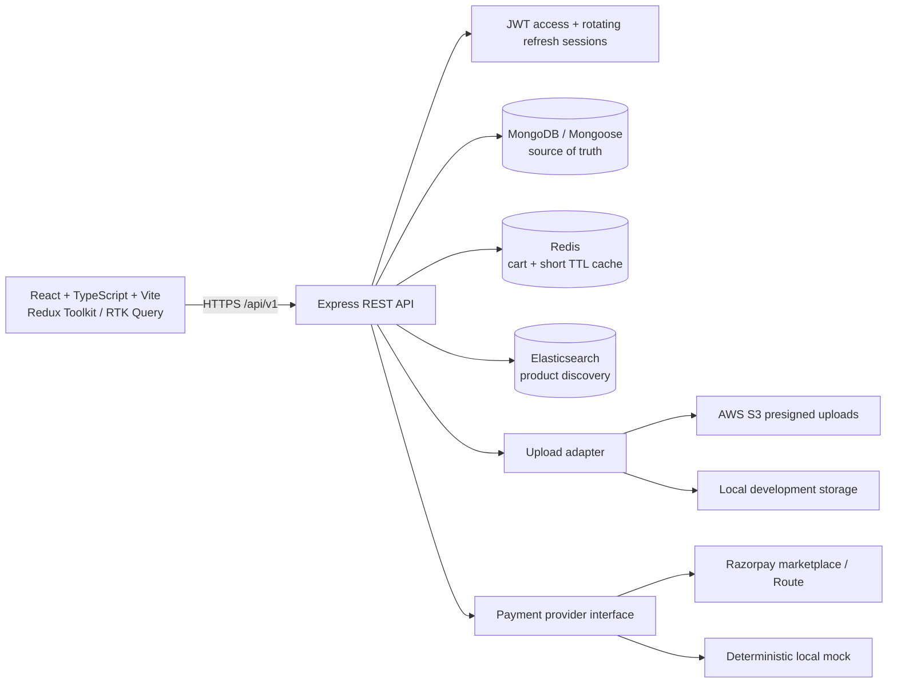

# FS-01 implementation plan

## Assumptions and constraints

- The supplied empty `FS-01` workspace is the project root. There is no existing Git history or application to preserve.
- MongoDB, Redis, Elasticsearch, AWS, and payment credentials are not configured in this environment. Integrations will be implemented behind explicit adapters and their live status reported accurately.
- The first runnable slice prioritizes identity, role-aware APIs, and MongoDB-backed catalog data. Checkout/payment and vendor workflows follow this foundation.
- Local infrastructure will be documented with Compose, but Docker is not installed on this machine.

## Architecture

The API owns authorization and business calculations. MongoDB is authoritative; Redis and Elasticsearch are disposable projections/cache. Outbox events synchronize product search and ledger operations. Provider webhooks, not browser redirects, confirm payment.

## Initial collection design

| Collection | Purpose and key constraints |
|---|---|
| User | Email unique/indexed; password hash; role enum; account state. |
| RefreshSession | Hashed rotating token, expiry/revocation, user index. |
| VendorProfile | Unique user; onboarding/moderation state; public store profile. |
| Address | User-owned shipping address. |
| Category | Unique slug and parent reference. |
| Product | Vendor/category references; price in paise; unique vendor+SKU and slug; publication status. |
| Cart | Unique customer; item product/quantity; Redis cache with Mongo recovery. |
| Coupon | Unique code; validity and usage constraints. |
| Order | Customer, address snapshot, totals in paise, idempotency key. |
| OrderItem | Vendor-specific fulfillment state and price/commission snapshots. |
| Payment / Refund | Provider references, verified state transitions, idempotency keys. |
| CommissionRule | Effective-dated configuration. |
| VendorLedgerEntry | Immutable, unique source event; credits/debits and settlement state. |
| Review | Unique customer+product, verified purchase and moderation state. |
| Notification | User-owned delivery and read status. |
| AuditLog | Append-only actor/action/resource metadata for admin operations. |
| OutboxEvent | Retryable, idempotent search and domain event delivery. |

Relationship sketch: `User 1—0..1 VendorProfile`; `User 1—* Address/Cart/Order/RefreshSession`; `VendorProfile 1—* Product`; `Order 1—* embedded OrderItem/Payment`; each embedded order item snapshots a product and vendor and may have ledger entries. `AuditLog` and `OutboxEvent` reference source actors/resources. Category, refunds and reviews are planned relationships only.

## API inventory (v1)

| Method/path | Access | Purpose |
|---|---|---|
| POST `/api/v1/auth/register` | public, rate limited | Create customer account |
| POST `/api/v1/auth/login` | public, rate limited | Issue access + HttpOnly refresh cookie |
| POST `/api/v1/auth/refresh` | refresh cookie | Rotate refresh session |
| POST `/api/v1/auth/logout` | authenticated | Revoke refresh session |
| GET `/api/v1/auth/me` | authenticated | Current role-aware identity |
| GET `/api/v1/products` | public | Elasticsearch discovery when healthy; explicitly labeled MongoDB fallback otherwise |
| GET `/api/v1/products/:id` | public | Published product details |
| POST `/api/v1/vendors/application`, GET `/api/v1/vendors/me` | authenticated customer/vendor | Vendor onboarding/profile |
| GET `/api/v1/admin/vendors`, PATCH `/api/v1/admin/vendors/:id/status` | ADMIN | Application review and auditable approval/rejection/suspension |
| GET/POST/PATCH/DELETE `/api/v1/vendor/products...` | approved VENDOR | Owned product CRUD; edits require moderation |
| GET/PUT `/api/v1/cart` | CUSTOMER | MongoDB persistent cart with Redis cache |
| GET/POST `/api/v1/users/me/addresses` | CUSTOMER | Owned address book |
| POST `/api/v1/checkout` | CUSTOMER + `Idempotency-Key` | Multi-vendor order and stock reservation |
| POST `/api/v1/payments/mock/webhook` | HMAC signature | Local test payment confirmation; unavailable in production |
| GET `/api/v1/orders...`, GET/PATCH `/api/v1/vendor/orders...` | CUSTOMER / approved VENDOR | Ownership-checked order history and fulfillment |
| GET `/api/v1/vendor/ledger` | approved VENDOR | Payable ledger balance; no provider settlement |
| GET `/api/v1/admin/analytics/summary`, GET `/api/v1/admin/audit-logs` | ADMIN | MongoDB aggregations and admin audit records |
| GET `/api/v1/health/live` | public | Process liveness |
| GET `/api/v1/health/ready` | public | Dependency readiness |

## Milestone checklist

- [x] A: inspect workspace/runtime prerequisites, record architecture, initial data design, API inventory, assumptions, risks.
- [x] A: scaffold config, app shell, modular API and first vertical slice.
- [ ] B: complete identity and vendor onboarding/product moderation flows. (Application review and product moderation APIs exist; account recovery, uploads and dashboard UI remain.)
- [ ] C: Elasticsearch sync/search and Redis-backed persistent carts. (Adapters, outbox, indexed search fallback and cart API exist; live services are unverified.)
- [ ] D: idempotent multi-vendor checkout, inventory, payment webhooks, commission ledger. (Core mock checkout and signed webhook path exist; transaction/recovery hardening and real provider remain.)
- [ ] E: reviews, coupons, invoices, analytics and dashboards. (Admin summary and vendor ledger APIs exist; reviews, coupons, PDF invoices and dashboard UI remain.)
- [ ] F: test report, responsive review, deployment docs, screenshots, presentation, acceptance checklist.

Progress is marked complete only after executable evidence exists; unavailable cloud infrastructure remains a disclosed integration blocker.
