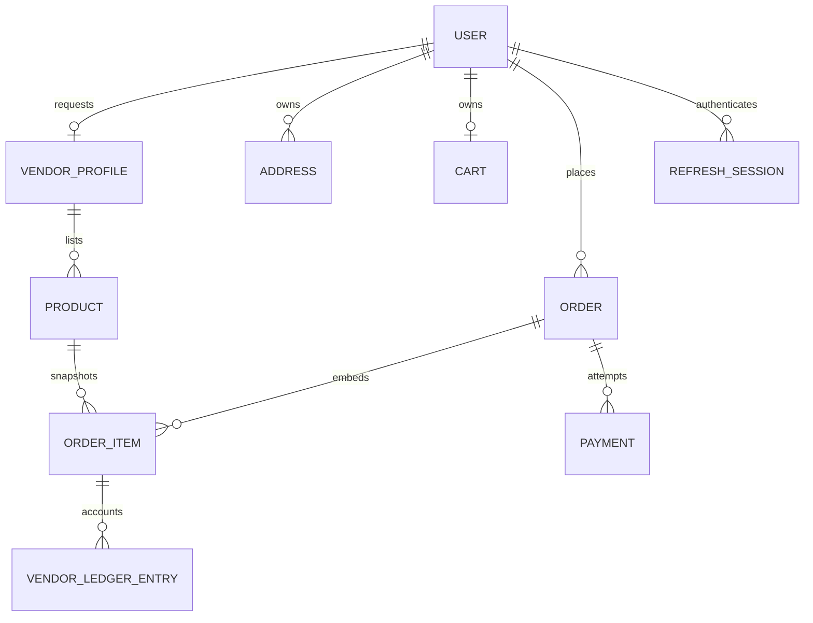

# Data model

Money values are integer paise. Timestamps are UTC. MongoDB remains authoritative; indexes are declared in Mongoose schemas. **Implemented Mongoose collections:** User, RefreshSession, VendorProfile, Address, Product, Cart, Order, Payment, VendorLedgerEntry, AuditLog and OutboxEvent. Category is currently a validated product string; the normalized category collection and the planned-only collections below are not implemented yet.



| Collection | Purpose, constraints, indexes and relationships |
|---|---|
| User | Identity and server-controlled `CUSTOMER/VENDOR/ADMIN`; normalized unique email; password hash excluded by default; active/suspended status. |
| RefreshSession | User reference; SHA-256 token hash unique; expiry TTL; revocation timestamp. Raw refresh token is only sent in HttpOnly cookie. |
| VendorProfile | One-to-one user; store details, application/approval/suspension state, payout configuration reference (never provider secret). |
| Address | User-owned shipping data; snapshots copied into placed orders. |
| Category (planned) | Hierarchy, unique slug, visibility and sort rank. |
| Product | Vendor reference; category is currently a string; integer `pricePaise`; unique slug; status controls public visibility; vendor/status/category indexes. SKU is not implemented. |
| ProductImage (planned) | Product reference, object key, dimensions, content type and moderation metadata; no arbitrary external keys. |
| Cart / CartItem | One cart per customer; persisted product references/quantities plus Redis cached projection with expiry. Server reloads prices at checkout. |
| Coupon (planned) | Unique normalized code, validity, limits, eligibility and usage counters protected during checkout transaction. |
| Order / OrderItem | Parent order captures customer/address snapshot/totals/idempotency key. Item snapshots include vendor, price, commission and independent fulfillment state. Tax/shipping/discount allocations are currently zero/not configured. |
| Payment / Refund | Payment attempt and signed mock event are implemented; real provider adapters, refunds and refund state transitions are planned. |
| CommissionRule (planned) | Effective date, basis points, optional fixed paise fee, category/vendor scope, admin audit reference. Current commission is one environment-configured basis-point value. |
| VendorLedgerEntry | Unique source event, vendor/order item, paise amount and payable state. Current entries record sale payable credit; refunds/debits/settlement reconciliation are planned. |
| Review (planned) | Unique customer+product, verified order-item reference, rating 1–5, bounded body and moderation state. |
| Notification (planned) | Recipient, type, referenced entity and read/delivery state. |
| AuditLog | Administrative actor, action, target, request ID and summary. |
| OutboxEvent | Unique event ID, product entity, bounded retry count, pending/dead status and last error; synchronizes Elasticsearch. |

Standalone MongoDB does not support multi-document transactions. Local Compose is a single-node replica set only if configured for one; until then, critical checkout must use reservations with compensating release and idempotency, or developers can enable a replica set. Production requires a replica set or sharded cluster and integration tests against it.

Sample sanitized product:

```json
{"_id":"6650a1b2c3d4e5f678901234","name":"Everyday Canvas Tote","slug":"everyday-canvas-tote","category":"Accessories","vendorId":"6650a1b2c3d4e5f678901200","pricePaise":149900,"stock":24,"status":"PUBLISHED","ratingAverage":4.7,"ratingCount":18}
```
